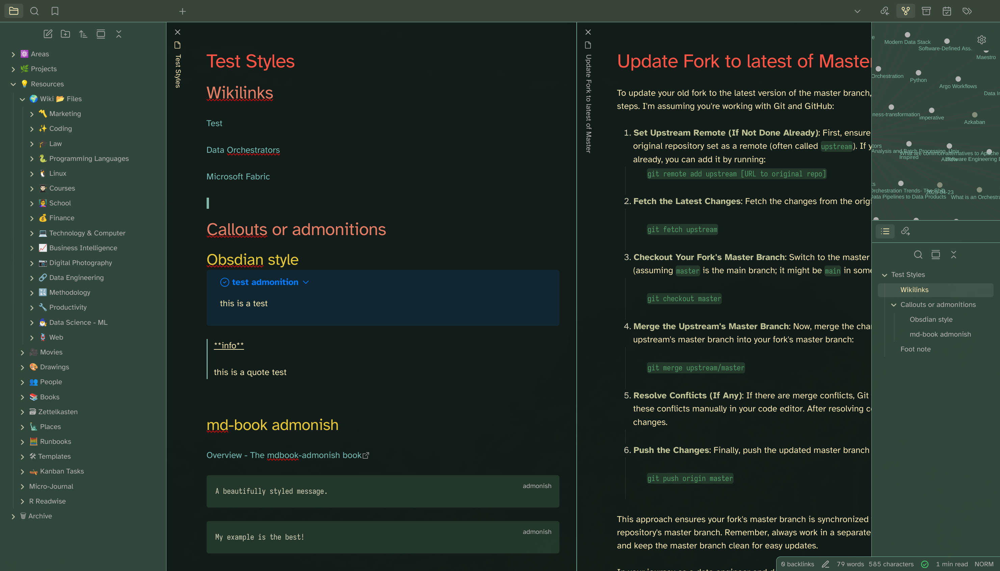
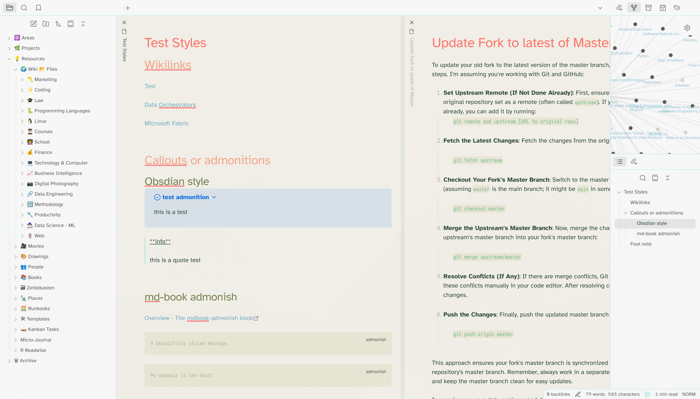

# Osaka Jade (Obsidian Theme)
This is a [Osaka Jade](https://github.com/Justikun/omarchy-osaka-jade-theme) theme for [Obsidian](https://obsidian.md/). It supports dark and light mode.

Installation: Simply search `Osaka Jade` in the Obsidian Communitiy Themes and Install. Or if manually, copy the `obsidian.css` file to your vault directory and reload Obsidian for it to take effect.

## Dark Mode


## Light Mode



### Bump Version

```sh
npm run version
```


---

*Check also my other Themes I created, [Kanagawa](https://github.com/sspaeti/obsidian_kanagawa), [Kanagawa Paper](https://github.com/sspaeti/obsidian_kanagawa_paper/), [Rosé Pine](https://github.com/sspaeti/obsidian_rose_pine/), [Asia Neon](https://github.com/sspaeti/obsidian_asia_neon/), [Fireplace](https://github.com/sspaeti/obsidian_fireplace/).*
